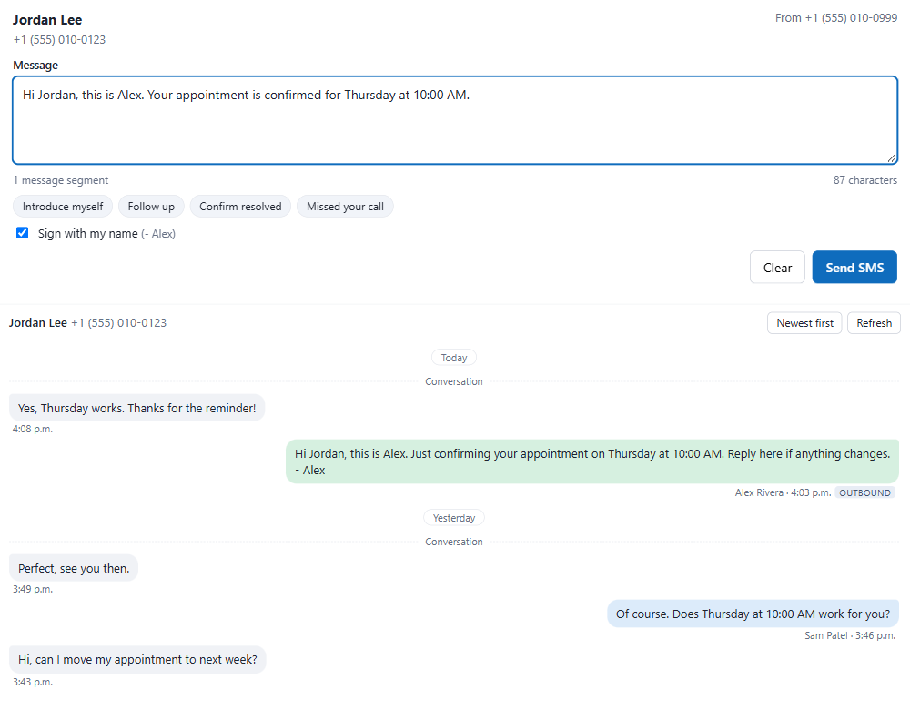

# Agent-initiated SMS for Dynamics 365 Contact Center

Out of the box, a human agent in Dynamics 365 Contact Center (or Omnichannel for Customer Service) **cannot start an SMS conversation**. Microsoft's documentation says so explicitly: representatives can't proactively reach out to customers by starting an SMS conversation in the app. SMS outbound is only available through Power Automate flows and proactive engagement APIs.

This solution adds that missing piece:

1. A **Send SMS** tab on the Contact form. The agent types a message and sends it.
2. **Reply routing.** When the customer answers, the conversation is routed back to the agent who sent the text, not to a bot or a random queue.
3. A **Text message history** thread on the Contact form and on the conversation form, so the agent sees the whole story (earlier conversations and the texts they sent) when a reply arrives.

It is a small managed Dataverse solution (three HTML web resources, one security role and one optional Contact form). There is no plug-in, no Power Automate flow, no Azure resource and no hardcoded environment value. Everything is discovered at run time.



*The screenshots use made-up data.*

---

## Contents

- [How it works](#how-it-works)
- [Requirements](#requirements)
- [Install](#install)
- [Add the tab to your forms](#add-the-tab-to-your-forms)
- [One-time setup](#one-time-setup)
- [Make replies reach the agent who sent the text](#make-replies-reach-the-agent-who-sent-the-text)
- [Using it](#using-it)
- [What gets created in your environment](#what-gets-created-in-your-environment)
- [Limitations](#limitations)
- [Troubleshooting](#troubleshooting)
- [Uninstall](#uninstall)
- [Build from source](#build-from-source)
- [Repository layout](#repository-layout)

---

## How it works

**Sending.** The Send SMS tab calls Microsoft's own outbound messaging action, `msdyn_InvokeOutboundAPI`, the same action used by the documented Power Automate outbound flows. It passes an *outbound configuration* (SMS channel, sender number and a message template whose body is just the `{message}` slug) and the text the agent typed. The sent message is logged as a `msdyn_ocoutboundmessage` activity linked to the contact, so it also shows in the contact's timeline.

**Routing the reply.** Before sending, the panel writes a *preferred representative* row (`msdyn_preferredagent`) that makes the sending agent the contact's preferred agent. It is marked temporary and a previous temporary row for the same contact is replaced, so there is always at most one. When the customer replies, Contact Center identifies the contact by the incoming phone number, and preferred representative routing assigns the new conversation to that agent.

**History.** SMS conversations are separate records, and a reply starts a new one with no link to the text that triggered it. The history panel stitches them together. It finds conversations by phone number (the conversation subject starts with the customer's number) or by customer, reads the transcripts of the closed ones, adds the texts sent from the Send SMS tab, and renders a single thread. It refreshes every 30 seconds.


---

## Requirements

| Requirement | Details |
|---|---|
| Product | Dynamics 365 Contact Center (standalone or embedded) or Omnichannel for Customer Service |
| SMS channel | An SMS channel already provisioned and working, with a number that has **outbound SMS enabled** (Twilio, Infobip or Azure Communication Services). Note that Microsoft has deprecated SMS through Azure Communication Services, so prefer Twilio or Infobip for new setups |
| SMS workstream | At least one active SMS workstream, push-based, with a queue your agents belong to |
| Admin rights for install | System Administrator (or equivalent) to import the solution |
| Admin rights for first-run setup | Omnichannel administrator or System Administrator (creates one template and one configuration) |
| Agent permissions | The built-in **Omnichannel agent** role plus the **Agent SMS Console User** role from this solution |
| Preferred representative routing | Must be enabled in Copilot Service admin center. See [below](#make-replies-reach-the-agent-who-sent-the-text) |

---

## Install

1. Go to the [Releases](../../releases) page and download **`AgentSmsConsole_<version>_managed.zip`**. Use the *unmanaged* zip only if you want to edit the components yourself.
2. In [make.powerapps.com](https://make.powerapps.com), choose your environment, open **Solutions**, then **Import solution**, select the zip and follow the wizard. No connection references or environment variables are needed.
3. Wait for the import to finish (a few minutes).

You can also import with the Power Platform CLI:

```
pac auth create --environment https://yourorg.crm.dynamics.com
pac solution import --path AgentSmsConsole_1.0.0_managed.zip --publish-changes
```

Or with the Web API (`ImportSolution` or `ImportSolutionAsync`) using any HTTP client and a bearer token for your org.

To upgrade later, import the newer zip over the old one. The component IDs are fixed, so it upgrades in place.

---

## Add the tab to your forms

The solution adds the pieces; you decide where they appear. There are two ways to add the tab to the Contact form.

### Option A: use the included form (fastest)

The solution ships a ready-made Contact form called **Contact - Agent SMS** with a General tab and a Send SMS tab.

1. Open your model-driven app (for example Customer Service workspace or Contact Center workspace) in the **App designer**.
2. Under **Pages**, open the **Contact** table, choose **Forms**, tick **Contact - Agent SMS**, then **Save and publish**.
3. Agents can pick the form from the form selector on a contact.

This form only has a few basic fields. If you already have a customized contact form, use option B instead.

### Option B: add the tab to the form you already use

Run the helper script. It only needs Node.js 18+ and the Azure CLI (`az login`), or a bearer token in `DATAVERSE_TOKEN`. It is idempotent, so running it twice changes nothing.

```
node scripts/add-to-forms.mjs --org https://yourorg.crm.dynamics.com ^
     --contact-form "Customer Form" ^
     --conversation-forms "Active Conversation,Conversation Form"
```

(Use `\` instead of `^` on macOS and Linux.)

- `--contact-form` is the **name** of the Contact main form to extend. It adds a **Send SMS** tab containing the composer and the history.
- `--conversation-forms` is an optional, comma-separated list of conversation (`msdyn_ocliveworkitem`) main forms. It adds a **Text message history** section at the top of the first column. In the Contact Center workspace the *Active Conversation* form is the **Customer Summary** tab that opens next to the communication panel, so this puts the history right next to the live chat.
- Add `--remove` to take the additions out again.

The script edits the form XML in the *unmanaged* layer and publishes the table. If you prefer to do it by hand, in the form designer add a **tab** with a **web resource** control: Contact form, web resource `asms_/contact.html` (composer plus history); conversation forms, web resource `asms_/history.html`. In the control properties, clear *Pass record object-type code and unique identifier*, set scrolling to *Auto* and untick *Display border*.

### Why isn't the history inside the communication panel itself?

Microsoft does not offer an extension point that lets you add custom content to the communication panel (the left-hand chat pane). The Customer Summary tab, which sits right beside it and opens with every conversation, is the closest supported place.

---

## One-time setup

Assign the **Agent SMS Console User** security role to every agent who will send texts (in addition to Omnichannel agent). The role contains one thing: permission to create and delete the preferred-representative row the panel uses for reply routing.

Then an administrator creates the sending configuration:

1. As an Omnichannel administrator or System Administrator, open any contact and select the **Send SMS** tab.
2. Because no configuration exists yet, the panel shows a **One-time setup** box listing every SMS number in the environment that has outbound enabled.
3. Pick the number agents will text from and select **Set up SMS sending**.


This creates, in your environment:

- a message template named **Agent SMS - free text** whose body is `{message}`
- an outbound configuration named **Agent SMS - <number>** for the chosen number, set to the first active SMS workstream

The setup box only appears while no configuration exists. To add a second SMS number later, create another outbound configuration for it in Copilot Service admin center (Customer settings, Outbound, New), name it `Agent SMS - <number>`, choose channel type SMS, the channel number and the **Agent SMS - free text** template, and set *Conversation record* to *Create conversation on send*. When several configurations exist, agents see a **Send from** picker.

The panel finds configurations by their name prefix `Agent SMS`, so you can also create or rename them yourself in Copilot Service admin center under Customer settings, Outbound.

---

## Make replies reach the agent who sent the text

This is the part that needs a few settings, and they are all in your environment, not in this solution.

1. **Turn on preferred representative routing.** In Copilot Service admin center go to **Routing**, then **Preferred representative routing**, and switch on **Enable preferred representative routing**. Under *Who should get the work if the preferred representative cannot be assigned work?* pick:
   - *Next best representative based on assignment logic*, so the reply is never stuck, or
   - *No one. Let the work remain unassigned in the queue*, which Microsoft recommends for asynchronous channels such as SMS, so that nobody else picks up a conversation meant for one agent. An agent who is offline then leaves the reply waiting in the queue.
2. **Remove the bot from the SMS workstream** (or use a separate workstream and number for agent-initiated texts). A workstream with a bot sends every incoming SMS to the bot first, so the reply lands there. In my testing, a reply to an agent's text went to the bot until the bot was removed from the workstream, and after that the new conversation was assigned directly to the sending agent. To let a bot handle other SMS traffic, give the agent-initiated number its own workstream without a bot.
3. **Agents must be members of the queue** the SMS workstream routes to, and their presence must be one of the workstream's *Allowed presences*. Preferred routing skips capacity, skills and assignment rules, but not queue membership or presence.
4. **Make sure the customer can be identified.** Contact Center matches the sender of an SMS to a contact by **Mobile Phone** in E.164 format (for example `+14165551234`). If two contacts have the same mobile number, the customer is left unidentified and the preferred-agent rule can't apply. Keep mobile numbers unique. The Send SMS tab saves a number to Mobile Phone for you when the contact has none.

Routing relies on documented features (preferred representative routing, push workstreams, identification by phone number), but Microsoft does not document this exact combination. Test it in your own environment, as described in [Troubleshooting](#troubleshooting).

---

## Using it

1. Open a contact and select **Send SMS**.
2. Check the recipient and the sending number at the top. If the contact has no mobile number, enter one.
3. Type a message, or start from a quick-reply chip (*Introduce myself*, *Follow up*, *Confirm resolved*, *Missed your call*). The counter shows message segments, and special characters such as curly quotes or emoji switch the text to Unicode, which allows fewer characters per segment.
4. Leave **Sign with my name** ticked to append your first name, or untick it.
5. Select **Send SMS** (or press Ctrl+Enter). The panel confirms delivery to the carrier, and the history below updates.
6. When the customer replies, the new conversation is assigned to you. The **Customer Summary** tab shows the **Text message history** with your earlier text above their reply.

If the contact is flagged **Do not allow Phone Calls**, the panel asks the agent to confirm that the customer agreed to receive texts before it will send.

**Compliance.** The panel sends exactly what the agent types to a number you give it. Your organization is responsible for consent, quiet hours, opt-out handling and do-not-contact rules. Carriers and regulations such as TCPA and 10DLC registration apply to your sending number.

---

## What gets created in your environment

Installed by the solution:

| Component | Name |
|---|---|
| Web resource | `asms_/composer.html`: the send panel |
| Web resource | `asms_/history.html`: the history thread |
| Web resource | `asms_/contact.html`: composer and history on one page (used by the Send SMS tab) |
| Security role | **Agent SMS Console User** (create/read/write/delete/append on `msdyn_preferredagent`) |
| Form | **Contact - Agent SMS** (Contact table) |

Created at run time:

| Record | When |
|---|---|
| Message template `Agent SMS - free text` and a localization row | One-time setup |
| Outbound configuration `Agent SMS - <number>` | One-time setup |
| `msdyn_preferredagent` row per contact (temporary) | Each send |
| `msdyn_ocoutboundmessage` activity | Each send (Microsoft's own log) |
| Contact Mobile Phone | Only when the contact had none and the agent entered one |

---

## Limitations

- **Not inside the communication panel.** See the explanation above; the history sits in the Customer Summary tab beside it.
- **The history reads closed conversations.** The live conversation stays in the communication panel; the history shows everything before it. The panel skips the conversation that is currently open.
- **Matching is by phone number.** The history finds conversations whose subject starts with the customer's number, and conversations whose customer is the contact. It only covers the SMS channel, and only the last 100 texts sent from the tab, and a limited number of earlier conversations per load (a **Load older conversations** button appears when there are more).
- **Preferred agent is per contact, not per conversation.** The newest sender wins. The row is replaced on every send, so the last agent to text a contact receives the reply.
- **The first reply is a new conversation.** Microsoft's API has no parameter to create a conversation owned by the sender at send time, and in testing the customer's reply always arrived as a new conversation with no link to the outbound text. The history panel exists to bridge that gap. The outbound configuration uses the *Create conversation on send* option (`msdyn_type` 100000001); Microsoft does not document what it does at run time, so this solution does not depend on it.
- **Tested as a System Administrator.** Role privileges for non-admin agents were derived from the privilege names, and the agent-side send path (the outbound action, reading transcripts, writing the preferred-agent row) should be re-tested with a user who only has Omnichannel agent plus Agent SMS Console User.
- **SMS via Azure Communication Services is deprecated by Microsoft.** It works while it is supported, but use Twilio or Infobip for new setups.
- **WhatsApp and other channels are not covered.** Outbound templates, the 24-hour window and opt-in rules are different there.

---

## Troubleshooting

**The Send SMS tab shows "Couldn't read the SMS configuration".** The signed-in user lacks read access to `msdyn_ocoutboundconfiguration`. The built-in Omnichannel agent role includes it; check the user has that role.

**The setup box says no SMS number was found.** The panel lists numbers where *SMS outbound* is enabled. Provision and configure the SMS channel first (Copilot Service admin center, Channels, Phone numbers and SMS), then reopen the tab.

**Setup fails with a permission error.** Run it as an Omnichannel administrator or a System Administrator.

**The text is delivered but the reply goes to the bot or to the queue.** Check, in order:
1. The SMS workstream has no bot (Workstreams, open it, *AI agent* / bot setting).
2. Preferred representative routing is on (Routing, Preferred representative routing).
3. The agent is in the workstream's queue and is *Available* (or another allowed presence).
4. Exactly one contact has the customer's mobile number, in E.164 format.
5. The workstream is push-based. Preferred routing does not apply to pick workstreams.
6. After changing workstream or routing settings, wait up to 15 minutes; Omnichannel configuration changes are not instant.

**"Couldn't send" with a message about the contact list.** The text is empty or the number is invalid. Use E.164 (`+` and country code).

**"Sent, but replies may not come back to you: ... msdyn_preferencerating".** The panel wrote an invalid preference rating. Update to the latest release (it uses rating 1; the allowed range is 1 to 3).

**The history is empty.** The customer has no earlier SMS conversation, or the conversation subject doesn't start with their number and the conversation has no customer. Open **Refresh**.

**The tab doesn't appear.** Publish all customizations, open the contact with the form that has the tab (Form selector), and hard refresh with Ctrl+F5.

---

## Uninstall

1. Remove the tab and sections from forms you added them to: `node scripts/add-to-forms.mjs --org <url> --contact-form "<form>" --conversation-forms "<names>" --remove`.
2. If you used the **Contact - Agent SMS** form, remove it from your apps in the App designer (an app that includes the form blocks uninstall with "Solution dependencies exist").
3. Delete the solution **Agent SMS Console** (Solutions, select it, Delete). Unassign the **Agent SMS Console User** role from users first if the platform asks.
4. Optionally delete the records created at run time: the `Agent SMS` outbound configuration(s), the message template **Agent SMS - free text** and any `msdyn_preferredagent` rows with the name *Agent SMS reply routing*.

---

## Build from source

Requires Node.js 18 or later and nothing else.

```
npm run build
```

This writes `dist/AgentSmsConsole_<version>_managed.zip` and `..._unmanaged.zip`. The build is reproducible (fixed timestamps and component IDs), so rebuilding unchanged sources gives identical files.

To change the version, edit `version` in `package.json` (the solution version is that value plus `.0`).

## Repository layout

```
src/composer.html        send panel (setup, recipient, message, send, reply routing)
src/history.html         text message history thread
src/contact.html         page hosting composer and history on the contact form
src/contact-form.xml     the Contact - Agent SMS form
build/build.mjs          builds the solution zips with no dependencies
build/entities.template.xml  entity block used by the build
scripts/add-to-forms.mjs adds or removes the panels on your existing forms
docs/images/             screenshots (mock data)
```

## License

MIT. See [LICENSE](LICENSE). This project is not affiliated with or endorsed by Microsoft. It uses documented Dataverse tables and actions plus a small number of tables whose behavior Microsoft has not fully documented; use it at your own risk and test it in a non-production environment first.
