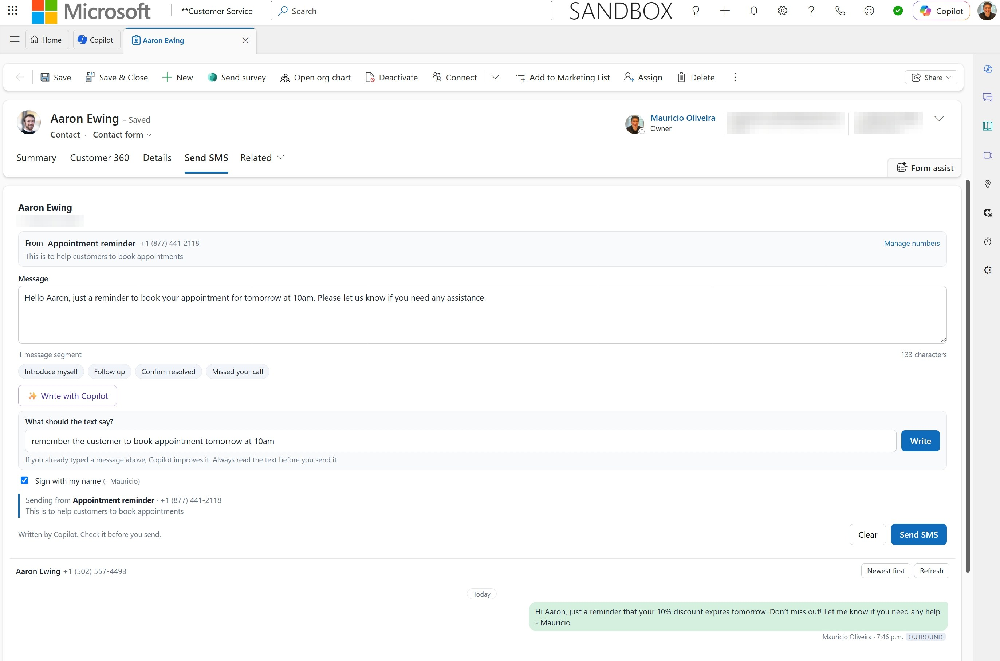
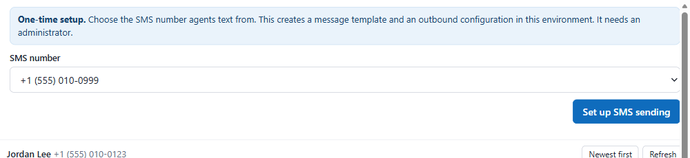
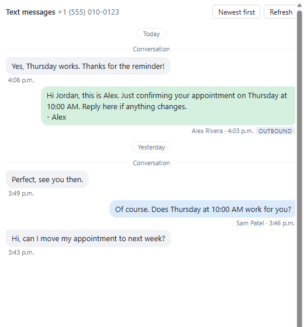
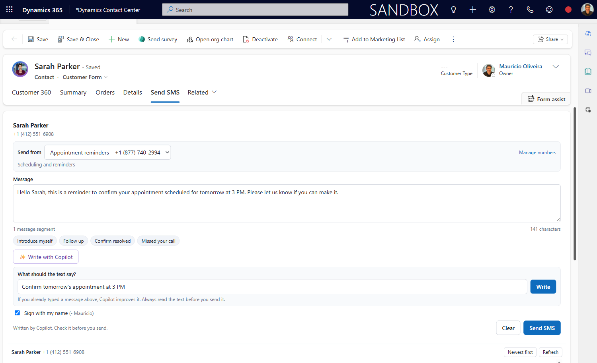
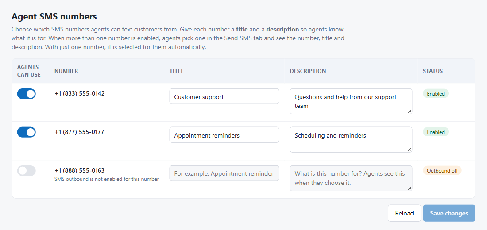

# Agent-initiated SMS for Dynamics 365 Contact Center

**Let your agents start a text conversation with a customer, straight from the contact record.**

Out of the box, a human agent in Dynamics 365 Contact Center (or Omnichannel for Customer Service) **cannot start an SMS conversation**. Microsoft's documentation says so: representatives can't proactively reach out to customers by starting an SMS conversation in the app. This free, open-source add-on fixes that.



*The first screenshot is from a test environment. The others use made-up data.*

| What the agent gets | How |
|---|---|
| **A Send SMS tab on the contact** | Type a message, press Send. |
| **Replies come back to the same agent** | Not to a bot, not to a random queue. |
| **The whole text history in one thread** | Earlier conversations plus the texts the agent sent, shown on the contact and next to the live conversation. |

It is a small Dataverse solution: three web resources, one security role and one optional form. **No plug-in, no Power Automate flow, no Azure resource, nothing to configure in code.** Everything is discovered when it runs.

---

## Start here: choose how you want to install

| | Best for | Time |
|---|---|---|
| **[Option 1. Let an AI assistant install it](#option-1-let-an-ai-assistant-install-it)** | You want to paste one prompt and answer a few questions. | about 10 min |
| **[Option 2. One command](#option-2-one-command)** | You are comfortable with a terminal. | about 5 min |
| **[Option 3. Click by click](#option-3-click-by-click)** | You prefer the Power Apps portal, or can't run scripts. | about 20 min |

All three end the same way: send yourself a test text. First, check you have what you need.

### Before you start (checklist)

- [ ] **Dynamics 365 Contact Center** (standalone or embedded) or **Omnichannel for Customer Service**.
- [ ] An **SMS number that already works** in Contact Center, with **outbound SMS turned on** (Twilio or Infobip; Microsoft has deprecated SMS through Azure Communication Services). Don't have one? Set up the channel first: *Copilot Service admin center > Channels > Phone numbers*.
- [ ] A **push-based SMS workstream** with a queue your agents belong to.
- [ ] You are a **System Administrator** (or Omnichannel administrator) in the environment.
- [ ] Your **environment URL**, for example `https://contoso.crm.dynamics.com`. Find it in the Power Platform admin center, under *Environments*, as *Environment URL*.

> **Try it in a sandbox or developer environment first.** The solution only adds a tab, a role and three web resources, but you should still test before production.

---

## Option 1. Let an AI assistant install it

Copy the whole prompt below into an AI assistant that can run commands and, ideally, use a browser (for example **GitHub Copilot CLI**, **Claude Code**, or an assistant with computer use). It finds your environment, installs everything, checks each step, and finishes with a test text. It can't sign in for you: **you sign in yourself**, including MFA. If it can't use a browser, it walks you through the few clicks instead.

> **Nothing to edit.** Paste it as is. Anything in `<angle brackets>` is filled in by the assistant.

```
You are an installation engineer. Install the community solution "Agent-initiated SMS for Dynamics 365 Contact Center" for me, end to end, carefully and safely.

SOURCE
Repository (public): https://github.com/moliveirapinto/d365-agent-initiated-sms
README (source of truth): https://raw.githubusercontent.com/moliveirapinto/d365-agent-initiated-sms/main/README.md
Get a local copy first: git clone https://github.com/moliveirapinto/d365-agent-initiated-sms.git (or download the latest release zip from https://github.com/moliveirapinto/d365-agent-initiated-sms/releases). Work from the clone.
Key files: scripts/install.mjs (one-command installer; it downloads the solution zip AgentSmsConsole_<version>_managed.zip from the latest release by itself, do NOT unzip it), scripts/add-to-forms.mjs (adds the panels to forms; "all" = every main form). Read the README first. If it and this prompt disagree, follow the README and tell me.

WHAT THE SOLUTION DOES
It adds a "Send SMS" tab to the main Contact forms so a human agent can start an SMS conversation, routes the customer's reply back to the agent who sent the text (preferred representative routing), and shows the whole text history on the contact and on the conversation forms. Supervisors choose which SMS numbers agents can use on a "Manage numbers" page and give each number a title and a description; the agent sees them in a "Send from" picker and again as "Sending from ..." right above the Send SMS button. A "Write with Copilot" button drafts the text with an AI Builder prompt. It installs a managed solution "AgentSmsConsole" (4 web resources, 1 table "Agent SMS Number", 2 security roles "Agent SMS Console User" and "Agent SMS Supervisor", 1 form "Contact - Agent SMS") and creates an AI Builder prompt "Agent SMS Draft". It does NOT replace or delete anything.

HOW TO WORK
- Use the tools you have (shell, Azure CLI, Node.js, browser). If you cannot operate a browser, switch to GUIDE MODE for the browser-only steps: ONE step at a time with exact click paths, wait for me to say "done", and verify what I report.
- Never guess. If a screen, name or value differs from what the README says, STOP and tell me exactly what you see.
- Retry a failed action at most twice, then stop and show me the exact error.
- Only do what is listed here. Do not delete or change any other record, form, workstream, queue, bot, flow or solution. Never touch an environment other than the one I name.
- Sign-in: I sign in myself, including MFA. Tell me when you need it, then wait. Never ask me to paste passwords or tokens, and never store any.
- Anything that can affect LIVE customers (removing a bot from a workstream, changing routing settings, installing in a production environment) needs my explicit "yes" first. Say exactly what will change.
- After each phase give one or two lines of status (OK / WARNING / FAILED) before continuing.

PHASE 0 - DISCOVER FIRST, ASK AS LITTLE AS POSSIBLE
Do NOT interview me. Work out what you can and ask at most ONE short message, only about things you could not determine.
1. Tools: check node --version (need 18 or newer) and az --version. If Node.js is missing, tell me to install it from https://nodejs.org and wait. If the Azure CLI is missing, tell me to install it from https://aka.ms/installazurecliwindows (Windows) or https://learn.microsoft.com/cli/azure/install-azure-cli and wait.
2. Sign-in: run "az login" (I sign in myself). If I have several subscriptions, any is fine: the installer authenticates against the environment itself.
3. Environment: list the environments I can see (GET https://api.powerapps.com/providers/Microsoft.PowerApps/environments?api-version=2016-11-01 with a token from "az account get-access-token --resource https://service.powerapps.com", keep those with properties.linkedEnvironmentMetadata.instanceUrl). Pick the one that has the table Conversation (msdyn_ocliveworkitem). If several do, ask me which (show names and URLs). If I give you a URL, use that.
4. Production check: if the environment type is Production, STOP and ask for an explicit "yes, production".
5. Which agents get the role: default is everyone who has the "Omnichannel agent" role (--agents omnichannel). Offer to use a specific list of e-mails instead only if I ask.
Then show me ONE summary (environment, agents, forms that will be changed) and continue after my "yes".

PHASE 1 - PREVIEW (changes nothing)
Run: node scripts/install.mjs --org <environment URL> --agents omnichannel --dry-run
Show me the output. Expected: environment OK, Conversation table found, "Would import" the solution (or "Already installed"), the Contact forms (by default ALL main Contact forms, for example "Contact", "Contact form", "Contact Master", "Information", not only one) and the conversation forms listed, SMS sending either "Already set up" or "Would set up sending from <number>", the Copilot prompt "Would create" or already there, and the list of agents that would get the role.
- If it says no SMS number with outbound enabled was found: STOP. I must provision the SMS channel first (Copilot Service admin center > Channels > Phone numbers and SMS). Do not try to create channels yourself.
- If it lists several SMS numbers: ask me which one to set up first and add --sms-number <number>. The others are switched on later in Manage numbers (Phase 2b).

PHASE 2 - INSTALL
After my "yes", run the same command WITHOUT --dry-run (keep --sms-number if I chose one). It imports the solution, adds the Send SMS tab to ALL main Contact forms and the text history to ALL main conversation forms (so the tab shows whichever form the agent's app opens; the script skips portal, web, mobile, customer-card and embedded forms), creates the sending configuration for my SMS number, creates the "Agent SMS Draft" Copilot prompt, and gives the Agent SMS Console User role to the agents. It is safe to run again. If any step reports WARN or FAIL, show me the exact message and fix it using the README (Troubleshooting) before moving on.
Then CHECK THE TAB IS REALLY THERE: list the main Contact forms in the environment (systemforms, objecttypecode contact, type 2) and confirm every one the script did not skip contains the web resource asms_/contact.html; if a form that agents open is missing it, run node scripts/add-to-forms.mjs --org <environment URL> --contact-form "<that form name>". In Phase 4, tell me which form name shows under the contact's name (e.g. "Contact form") so we know it is covered.
Verify read-only with the Web API or by re-running the dry run: solution AgentSmsConsole is installed, roles "Agent SMS Console User" and "Agent SMS Supervisor" exist, an outbound configuration named "Agent SMS - <number>" exists, and the AI Builder prompt "Agent SMS Draft" is published (if it is missing, the Write with Copilot button is simply hidden: tell me, do not invent a workaround).

PHASE 2b - TITLES AND DESCRIPTIONS FOR THE SMS NUMBERS (browser or guide mode)
The agent sees each number's title and description before sending, so they must be filled in. Ask me, in ONE message, for a short title and a one-line description for each SMS number the installer found (for example "Appointment reminders" / "Scheduling and reminders") and which numbers agents may use. Then open any contact, select the Send SMS tab and click "Manage numbers" (you need the System Administrator or Agent SMS Supervisor role), switch on the numbers, type the titles and descriptions, and Save changes. In GUIDE MODE give me those clicks one at a time. Afterwards confirm that the "Send from" picker (or, with one number, the "Sending from" line above the Send SMS button) shows the title and description. Give the role "Agent SMS Supervisor" only to the people I name.

PHASE 3 - MAKE REPLIES REACH THE SENDING AGENT (browser, in Copilot Service admin center)
These are environment settings; the script cannot change them. Open https://admin.powerplatform.microsoft.com > Environments > my environment > Open Copilot Service admin center (or use the app URL I give you) and do, ONE at a time, each after my "yes" because they change live routing:
1. Routing > Preferred representative routing: switch ON "Enable preferred representative routing". For "if the preferred representative can't be assigned work" choose "No one. Let the work remain unassigned in the queue" (recommended by Microsoft for SMS), or "Next best representative" if I prefer replies never wait.
2. Workstreams > the SMS workstream: it must NOT have a bot / AI agent. Tell me if it has one. If it does, ask me whether to remove it or to create a separate SMS workstream and number for agent-initiated texts. Do not remove a bot without my "yes".
3. Check the workstream is push-based, its queue contains my agents, and the workstream's Allowed presences include Available.
4. Check contacts: customers are matched by Mobile Phone in E.164 format (+14165551234). If two contacts share the same mobile number, the reply can't be routed; tell me which contacts if you can find them.
Note: Omnichannel configuration changes can take up to 15 minutes to take effect.

PHASE 4 - TEST
Ask me to hard-refresh the app (Ctrl+F5), open a contact whose Mobile Phone is MY OWN mobile number, open the Send SMS tab, check that the title and description of the number show above the Send SMS button, optionally try Write with Copilot, and send a test text to myself. Then ask me to reply from my phone. Confirm: the text arrived; my reply shows up as a new conversation assigned to me; the Customer Summary tab of that conversation shows the "Text message history" with my sent text above the reply. Also tell me the reply-routing result honestly: if the reply did not come to me, go through Phase 3 again one setting at a time. If anything fails, use the README Troubleshooting section, one check at a time.

FINISH
Give me a short summary: what was installed, what changed in the environment, what I still need to do (if anything), and how to uninstall (README, Uninstall section).
```

---

## Option 2. One command

You need [Node.js 18 or newer](https://nodejs.org) and the [Azure CLI](https://learn.microsoft.com/cli/azure/install-azure-cli). No `npm install`.

**1. Get the files** (either way works):

```
git clone https://github.com/moliveirapinto/d365-agent-initiated-sms.git
cd d365-agent-initiated-sms
```

or download the source zip from the [latest release](../../releases/latest) and unzip it.

**2. Sign in** with an account that is System Administrator in your environment:

```
az login
```

**3. Preview what will happen** (changes nothing):

```
node scripts/install.mjs --org https://YOURORG.crm.dynamics.com --agents omnichannel --dry-run
```

**4. Install** (the same command without `--dry-run`):

```
node scripts/install.mjs --org https://YOURORG.crm.dynamics.com --agents omnichannel
```

The installer does everything in order and tells you what it did:

```
[1] Checking the environment
  OK   Contact Center / Omnichannel is installed
[2] Installing the solution
  OK   Solution imported (version 1.2.1.0)
[3] Adding the Send SMS tab and the text history to your forms
  OK   Forms updated and published
[4] Setting up SMS sending
  OK   Sending is set up from +1...
[5] Creating the Copilot prompt that helps agents write messages
  OK   Prompt "Agent SMS Draft" created and published
[6] Giving agents the Agent SMS Console User role
  OK   Role assigned to ...
```

| Option | What it does |
|---|---|
| `--agents omnichannel` | Gives the role to everyone who has the **Omnichannel agent** role. Or pass e-mails: `--agents anna@contoso.com,ben@contoso.com`. |
| `--sms-number +14165551234` | Only needed if your environment has more than one SMS number: it picks the first number to set up. Supervisors switch on the others later in **Manage numbers**. |
| `--contact-forms all` | Which Contact forms get the Send SMS tab. `all` (the default) = every main Contact form agents can open, so the tab shows whichever form the app uses. Or give names, e.g. `"Contact,Contact form"`. |
| `--conversation-forms all` | Which conversation forms get the history. `all` is the default. |
| `--skip-forms` | Don't touch any form. Use the included **Contact - Agent SMS** form instead. |
| `--force` | Reinstall even if the same version is already there. |

Running it twice is safe. Then do **[Step 5: turn on reply routing](#step-5-make-replies-reach-the-agent-who-sent-the-text)** below (two settings in the admin center) and **[test it](#step-6-test-it)**.

---

## Option 3. Click by click

### Step 1. Download the solution

Open the [Releases](../../releases/latest) page and download **`AgentSmsConsole_<version>_managed.zip`**.

### Step 2. Import it

1. Go to **[make.powerapps.com](https://make.powerapps.com)** and select your environment (top right).
2. Open **Solutions**, then **Import solution**.
3. **Browse** to the zip, select **Next**, then **Import**. No connections or settings are asked for.
4. Wait for the green "imported successfully" message (a minute or two).

Prefer the command line? `pac auth create --environment https://yourorg.crm.dynamics.com` then `pac solution import --path AgentSmsConsole_1.2.1_managed.zip --publish-changes`.

To upgrade later, import the newer zip over the old one.

### Step 3. Put the Send SMS tab on the contact form

**Easiest: use the form that ships with the solution.**

1. Open **make.powerapps.com > Apps**, edit your model-driven app (for example *Customer Service workspace* or *Contact Center workspace*).
2. Under **Pages**, select the **Contact** table, then **Forms**.
3. Tick **Contact - Agent SMS**, then **Save and publish**.
4. Agents pick that form from the form selector on a contact.

That form only has a few basic fields. **If you already use a customized contact form,** add the tab to it instead, either by script or by hand:

- **By script (recommended):** `node scripts/add-to-forms.mjs --org https://YOURORG.crm.dynamics.com --contact-form all --conversation-forms all`
- **By hand:** open the form in the form designer, add a **tab** with a **web resource** control, choose `asms_/contact.html`. In the control properties clear *Pass record object-type code and unique identifier*, set *Scrolling* to *Auto* and untick *Display border*. Save and publish. For the conversation form add a web resource `asms_/history.html` in a section at the top of the first column.

> **Why isn't the history inside the left-hand communication panel?** Microsoft doesn't offer a way to add custom content there. The **Customer Summary** tab that opens right beside it with every conversation is the closest supported place, so that's where the history goes.

### Step 4. One-time sending setup (one click)

1. Open any contact and select the **Send SMS** tab. (Sign in as System Administrator or Omnichannel administrator for this one step.)
2. A **One-time setup** box lists every SMS number that has outbound enabled.
3. Pick the number your agents will text from and select **Set up SMS sending**.



This creates a message template called **Agent SMS - free text** and an outbound configuration called **Agent SMS - &lt;number&gt;**. It only appears while no configuration exists.

*No SMS number in the list?* Your SMS channel isn't provisioned or doesn't have outbound enabled yet. Set it up in **Copilot Service admin center > Channels > Phone numbers**, then reopen the tab.

Now **give agents permission**: in the [Power Platform admin center](https://admin.powerplatform.microsoft.com), open your environment > **Settings > Users + permissions > Users**, select an agent, **Manage security roles**, and tick **Agent SMS Console User** (agents also keep **Omnichannel agent**). Repeat for each agent.

### Step 5. Make replies reach the agent who sent the text

Both Option 2 and Option 3 need this. These are environment settings, so they live in Copilot Service admin center, not in this solution.

1. **Turn on preferred representative routing.** *Routing > Preferred representative routing >* switch on **Enable preferred representative routing**. For "if the preferred representative can't be assigned work" choose:
   - *Next best representative based on assignment logic*, so a reply is never stuck, or
   - *No one. Let the work remain unassigned in the queue*, which Microsoft recommends for asynchronous channels like SMS. If the agent is offline, the reply waits in the queue for them.
2. **The SMS workstream must not have a bot.** *Workstreams >* open your SMS workstream and check the bot / AI agent setting. A workstream with a bot sends every incoming SMS to the bot first, so the reply lands there instead of with the agent. Remove the bot, or give agent-initiated texts their **own workstream and number** without a bot.
3. **Agents must be in the queue** the workstream routes to, and their presence must be one of the workstream's *Allowed presences*. Preferred routing skips capacity, skills and assignment rules, but not queue membership or presence.
4. **Customers need a unique mobile number** in E.164 format (`+14165551234`) in the contact's **Mobile Phone** field. If two contacts have the same mobile number, the customer can't be identified and the reply can't be routed.

> Omnichannel configuration changes can take **up to 15 minutes** to apply.

Routing uses documented features, but Microsoft doesn't document this exact combination. Test it in your own environment (next step).

### Step 6. Test it

1. Hard-refresh the app (**Ctrl+F5**).
2. Open a contact whose **Mobile Phone** is *your own* mobile number, then select **Send SMS**.
3. Type a message, press **Send SMS** (or Ctrl+Enter).
4. Reply from your phone.
5. A new conversation is assigned to you. Open its **Customer Summary** tab: the **Text message history** shows your sent text above the customer's reply.



It didn't work? Go to [Troubleshooting](#troubleshooting).

---

## Using it



*Made-up data. The tab in the Customer Service workspace, after Write with Copilot drafted the message.*

1. Open a contact and select **Send SMS**.
2. Check the recipient and the sending number at the top. If the contact has no mobile number, type one.
3. Type a message, or start from a quick-reply chip (*Introduce myself*, *Follow up*, *Confirm resolved*, *Missed your call*). The counter shows message segments; special characters such as curly quotes or emoji switch the text to Unicode, which allows fewer characters per segment.
4. Leave **Sign with my name** ticked to add your first name at the end, or untick it.
5. Select **Send SMS** (or press Ctrl+Enter). The panel confirms the text reached the carrier and the history updates.
6. When the customer replies, the conversation is assigned to you.

**Several SMS numbers.** If your supervisor has enabled more than one number, a **Send from** picker shows each number with its title and description. With one number it is selected for you. Right above the **Send SMS** button the panel repeats **Sending from: title, number and description**, so the agent can double-check which number the text goes out from before sending, and the "Delivered" message names the number that was used. A number with no title or description shows just the number; supervisors see an **Add a title and description** link next to it. Supervisors (and administrators) see a **Manage numbers** link that opens the admin page, where they switch numbers on or off and give each a title and description. The page needs the **Agent SMS Supervisor** role (or System Administrator).



*Made-up data. The Manage numbers page.*

**Write with Copilot.** Select **Write with Copilot**, describe what the text should say (for example, *confirm tomorrow's appointment at 3 PM*) and select **Write**. If you already typed a draft, Copilot improves it instead. The result lands in the message box for you to read and edit before sending. It uses an AI Builder prompt named **Agent SMS Draft** and consumes Copilot Credits (or AI Builder credits) like any prompt run. If the prompt is missing the button is hidden.

If the contact is flagged **Do not allow Phone Calls**, the panel asks the agent to confirm the customer agreed to receive texts before it sends.

**Will the customer's reply come to the agent who sent the text?** Yes, as long as the environment is set up for it. The panel makes the sending agent the customer's *preferred representative*, and the reply is routed to that agent. This only works when four things are true, all covered in [Step 5](#step-5-make-replies-reach-the-agent-who-sent-the-text): preferred representative routing is switched on, the SMS workstream has no bot, the agent is in the workstream's queue with an allowed presence, and the customer's mobile number on the contact is unique and in E.164 format. If the agent is offline or at capacity, the reply follows the *can't be assigned work* setting from Step 5: it either waits in the queue for that agent or goes to the next best representative. The installer does **not** change these settings, so check them before you rely on it.

**Compliance.** The panel sends exactly what the agent types to the number you give it. Your organization is responsible for consent, quiet hours, opt-out handling and do-not-contact rules, and carrier rules such as TCPA and 10DLC registration apply to your sending number.

---

## How it works

**Sending.** The Send SMS tab calls Microsoft's own outbound action, `msdyn_InvokeOutboundAPI`, the same action used by the documented Power Automate outbound flows. It passes an *outbound configuration* (SMS channel, sender number and a template whose body is just `{message}`) and the text the agent typed. The message is logged as a `msdyn_ocoutboundmessage` activity on the contact, so it also shows in the timeline.

**Routing the reply.** Before sending, the panel writes a *preferred representative* row (`msdyn_preferredagent`) that makes the sending agent the contact's preferred agent. It is temporary, and any previous temporary row for the contact is replaced, so there is at most one. When the customer replies, Contact Center identifies the contact by phone number and preferred representative routing assigns the new conversation to that agent.

**History.** SMS conversations are separate records, and a reply starts a new one with no link to the text that triggered it. The history panel stitches them together: it finds conversations by phone number or customer, reads the transcripts of the closed ones, adds the texts sent from the Send SMS tab, and renders one thread. It refreshes every 30 seconds.

---

## What gets created in your environment

Installed by the solution:

| Component | Name |
|---|---|
| Web resource | `asms_/composer.html`: the send panel |
| Web resource | `asms_/history.html`: the history thread |
| Web resource | `asms_/contact.html`: composer and history on one page (used by the Send SMS tab) |
| Web resource | `asms_/admin.html`: supervisors choose which SMS numbers agents can use |
| Table | **Agent SMS Number** (`asms_smsnumber`): the title, description and enabled state of each number |
| Security role | **Agent SMS Console User** (create, read, write, delete, append on `msdyn_preferredagent`; read on the SMS numbers table and on AI Builder prompts) |
| Security role | **Agent SMS Supervisor** (everything the agent role has, plus managing numbers and outbound configurations) |
| Form | **Contact - Agent SMS** (Contact table) |

Created when it runs:

| Record | When |
|---|---|
| Message template `Agent SMS - free text` and its localization row | One-time setup |
| Outbound configuration `Agent SMS - <number>` | One-time setup, and each time a supervisor enables a number on the admin page |
| AI Builder prompt `Agent SMS Draft` | Created by `scripts/install.mjs` (step 5) |
| `msdyn_preferredagent` row per contact (temporary) | Each send |
| `msdyn_ocoutboundmessage` activity | Each send (Microsoft's own log) |
| Contact Mobile Phone | Only if the contact had none and the agent typed one |

To send from another SMS number, open **Manage numbers** (in the Send SMS tab) and switch it on. The page creates the outbound configuration for you. You can still create one by hand in Copilot Service admin center (*Customer settings > Outbound > New*) named `Agent SMS - <number>`; it then appears on the admin page.

---

## Limitations

- **Not inside the communication panel.** The history sits in the Customer Summary tab beside it (see Step 3).
- **The history reads closed conversations.** The live conversation stays in the communication panel; the history shows everything before it.
- **Matching is by phone number.** The history finds conversations whose subject starts with the customer's number, and conversations whose customer is the contact. SMS only, the last 100 texts sent from the tab, and a limited number of earlier conversations per load (a **Load older conversations** button appears when there are more).
- **Preferred agent is per contact, not per conversation.** The last agent to text a contact receives the reply.
- **The first reply is a new conversation.** Microsoft's API can't create a conversation owned by the sender at send time, and in testing the customer's reply always arrived as a new conversation with no link to the outbound text. The history panel bridges that gap.
- **The Copilot prompt is created by the installer, not by the solution.** Microsoft doesn't support creating prompts from a solution zip you build yourself, so `scripts/install.mjs` creates **Agent SMS Draft** through the AI Builder publish action. With the click-by-click install, create a prompt with that exact name and the inputs `Customer`, `Agent`, `Task` and `Draft` (see `scripts/prompt-config.mjs`), or skip the feature.
- **Tested as a System Administrator.** Privileges for non-admin agents were derived from privilege names. Test the agent side with a user who has only Omnichannel agent plus Agent SMS Console User. Running the Copilot prompt was also verified as a user with only Read on AI Model and AI Template.
- **SMS via Azure Communication Services is deprecated by Microsoft.** Use Twilio or Infobip for new setups.
- **WhatsApp and other channels aren't covered.** Templates, the 24-hour window and opt-in rules differ there.

---

## Troubleshooting

**The tab doesn't appear.** Publish all customizations, open the contact with the form that has the tab (use the form selector), then hard refresh with Ctrl+F5.

**"Couldn't read the SMS configuration".** The signed-in user can't read `msdyn_ocoutboundconfiguration`. The built-in Omnichannel agent role includes it; check the user has that role.

**The Send SMS tab isn't on the contact.** The tab only exists on forms that were extended. Look at the form name shown under the contact's name (for example *Contact form*), then run `node scripts/add-to-forms.mjs --org <url> --contact-form "<that form name>"` (or `--contact-form all` for every main form), publish, and hard refresh with Ctrl+F5.

**The setup box says no SMS number was found.** The panel lists numbers where *SMS outbound* is enabled. Provision the SMS channel first (Copilot Service admin center > Channels > Phone numbers), then reopen the tab.

**Setup fails with a permission error.** Run it as an Omnichannel administrator or System Administrator.

**The text is delivered but the reply goes to a bot or the queue.** Check in this order:
1. The SMS workstream has no bot.
2. Preferred representative routing is on.
3. The agent is in the workstream's queue and is *Available* (or another allowed presence).
4. Exactly one contact has the customer's mobile number, in E.164 format.
5. The workstream is push-based. Preferred routing doesn't apply to pick workstreams.
6. You changed settings less than 15 minutes ago. Wait and retry.

**"Couldn't send" with a message about the contact list.** The text is empty or the number is invalid. Use E.164 (`+` and the country code).

**"Sent, but replies may not come back to you: ... msdyn_preferencerating".** Update to the latest release; it uses rating 1 (allowed range is 1 to 3).

**The history is empty.** The customer has no earlier SMS conversation, or the conversation subject doesn't start with their number and has no customer. Select **Refresh**.

**The installer says "Not signed in".** Run `az login` with an account that is System Administrator in the environment, then run it again.

**The installer says the Conversation table is missing.** The environment doesn't have Contact Center or Omnichannel for Customer Service installed.

---

## Uninstall

1. Remove the tab and section from forms you added them to: `node scripts/add-to-forms.mjs --org <url> --contact-form all --conversation-forms all --remove`.
2. If you used the **Contact - Agent SMS** form, remove it from your apps in the app designer (an app that includes it blocks the uninstall with "Solution dependencies exist").
3. Unassign the **Agent SMS Console User** role from users if the platform asks, then delete the solution **Agent SMS Console** (*Solutions >* select it *> Delete*).
4. Optional: delete the records created when it runs: the `Agent SMS` outbound configuration(s), the message template **Agent SMS - free text**, and any `msdyn_preferredagent` rows named *Agent SMS reply routing*.

---

## For developers

Build from source (Node.js 18 or newer, nothing else to install):

```
npm run build
```

This writes `dist/AgentSmsConsole_<version>_managed.zip` and `..._unmanaged.zip`. The build is reproducible (fixed timestamps and component IDs). To change the version, edit `version` in `package.json` (the solution version is that value plus `.0`).

```
src/composer.html            send panel (setup, recipient, message, send, reply routing)
src/history.html             text message history thread
src/contact.html             page hosting composer and history on the contact form
src/contact-form.xml         the Contact - Agent SMS form
build/build.mjs              builds the solution zips with no dependencies
scripts/install.mjs          one-command installer
scripts/add-to-forms.mjs     adds or removes the panels on your existing forms
docs/images/                 screenshots (made-up data)
```

## License

MIT. See [LICENSE](LICENSE). This is a community project, not affiliated with or endorsed by Microsoft. It uses documented Dataverse tables and actions plus a small number of tables whose behavior Microsoft hasn't fully documented. Use it at your own risk and test it in a non-production environment first.
